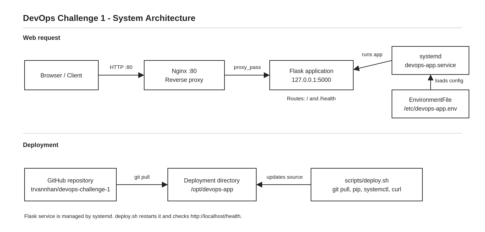

# DevOps Challenge 1 – Từ triển khai thủ công đến tự động

## 1. Tổng quan

Bài tập thực hành triển khai một ứng dụng Flask trên **Ubuntu chạy trong VMware Workstation**. Mục tiêu là đi từ việc chạy ứng dụng thủ công đến triển khai có thể lặp lại bằng Git, systemd, Nginx, biến môi trường và Bash script.

- **Repository:** https://github.com/trvannhan/devops-challenge-1
- **Tên hiển thị ứng dụng:** DevOps Challenge 1 - Team NHM
- **Thư mục phát triển:** `/home/vannhan/devops-challenge-1`
- **Thư mục triển khai:** `/opt/devops-app`
- **Địa chỉ truy cập trên Ubuntu:** `http://localhost`
- **Health check:** `http://localhost/health`

## 2. Kiến trúc hệ thống



**Luồng truy cập:** Trình duyệt → Nginx (cổng 80) → Flask (`127.0.0.1:5000`).

**Luồng triển khai:** GitHub → `git pull` tại `/opt/devops-app` → cài thư viện → restart systemd → kiểm tra `/health`.

- **Nginx** nhận yêu cầu HTTP và chuyển tiếp đến Flask.
- **Flask** xử lý hai route: `/` và `/health`.
- **systemd** quản lý tiến trình Flask, hỗ trợ tự chạy khi bật Ubuntu và tự khởi động lại theo cấu hình.
- **EnvironmentFile** tại `/etc/devops-app.env` cung cấp các biến cấu hình cho service.
- **`scripts/deploy.sh`** tự động cập nhật, cài dependencies, restart và health check.

## 3. Cấu trúc repository

```text
devops-challenge-1/
├── app.py
├── requirements.txt
├── .env.example
├── .gitignore
├── README.md
├── scripts/
│   └── deploy.sh
├── nginx/
│   └── devops-app.conf
├── systemd/
│   └── devops-app.service
└── docs/
    └── architecture.svg
```

## 4. Part 1 – Triển khai thủ công

Các bước đã thực hành:

1. Clone mã nguồn từ GitHub vào Ubuntu.
2. Tạo môi trường Python ảo (`venv`).
3. Cài các thư viện từ `requirements.txt` bằng pip.
4. Chạy Flask thủ công.
5. Kiểm tra kết quả bằng `curl` và trình duyệt.

Ví dụ thao tác tại thư mục mã nguồn:

```bash
python3 -m venv venv
source venv/bin/activate
pip install -r requirements.txt
python app.py
```

Mở Terminal khác để kiểm tra:

```bash
curl http://127.0.0.1:5000
curl http://127.0.0.1:5000/health
```

**Nhận xét:** Clone/update Git, tạo môi trường, cài thư viện, chạy ứng dụng và kiểm tra sức khỏe đều có thể tự động hóa. Việc xác định nguyên nhân khi triển khai lỗi vẫn thường cần người kiểm tra log và cấu hình.

## 5. Part 2 – Git Workflow

Nhóm sử dụng nhánh `feature/teamNHM` để chỉnh sửa nội dung trang chủ mà không thay đổi trực tiếp `main`.

Quy trình: tạo branch → sửa `app.py` → `git add` → `git commit` → chuyển về `main` → merge → push GitHub.

```bash
git checkout -b feature/teamNHM
# Sửa app.py rồi lưu
git add app.py
git commit -m "Add team NHM name to homepage"
git checkout main
git merge feature/teamNHM
git push origin main
```

Sau khi merge, trang chủ hiển thị `DevOps Challenge 1 - Team NHM`. Git giúp theo dõi phiên bản và tách phần phát triển chức năng khỏi nhánh chính.

## 6. Part 3 – Chạy Flask bằng systemd

File cấu hình: `systemd/devops-app.service`.

Các giá trị chính đang sử dụng:

| Cấu hình | Giá trị |
|---|---|
| User | `vannhan` |
| WorkingDirectory | `/opt/devops-app` |
| ExecStart | `/opt/devops-app/venv/bin/python /opt/devops-app/app.py` |
| EnvironmentFile | `/etc/devops-app.env` |
| Restart | `always` |
| RestartSec | `3` |

Các lệnh quản lý:

```bash
sudo systemctl daemon-reload
sudo systemctl enable devops-app
sudo systemctl start devops-app
systemctl status devops-app --no-pager
sudo systemctl restart devops-app
journalctl -u devops-app -n 20 --no-pager
```

**Kết quả:** Ứng dụng chạy dưới dạng service, không cần giữ Terminal chạy `python app.py` liên tục. Đã kiểm tra trạng thái `active` và endpoint Flask.

## 7. Part 4 – Nginx Reverse Proxy

Cấu hình Nginx lưu trong `nginx/devops-app.conf`:

- `listen 80`: nhận HTTP tại cổng 80.
- `proxy_pass http://127.0.0.1:5000`: chuyển request sang Flask.
- `proxy_set_header`: chuyển tiếp thông tin Host và IP khách.

Các thao tác thiết lập trên Ubuntu:

```bash
sudo cp nginx/devops-app.conf /etc/nginx/sites-available/devops-app
sudo ln -sfn /etc/nginx/sites-available/devops-app /etc/nginx/sites-enabled/devops-app
sudo rm -f /etc/nginx/sites-enabled/default
sudo nginx -t
sudo systemctl reload nginx
```

Kiểm tra:

```bash
curl http://localhost
curl http://localhost/health
```

**Kết quả:** Có thể truy cập ứng dụng qua Nginx bằng `http://localhost` mà không cần nhập `:5000`. Trong quá trình cấu hình đã gặp trang Nginx mặc định và lỗi cú pháp; sau khi kiểm tra site được bật, sửa file cấu hình và reload Nginx, các request hoạt động bình thường.

## 8. Part 5 – Cấu hình biến môi trường

Ứng dụng đọc biến môi trường bằng `os.getenv()`. File `.env.example` chứa giá trị mẫu; file cấu hình thực dùng cho systemd nằm ngoài repository tại `/etc/devops-app.env`.

| Biến | Ý nghĩa | Ví dụ |
|---|---|---|
| `APP_NAME` | Tên trên trang chủ | `DevOps Challenge 1 - Team NHM` |
| `APP_ENV` | Môi trường chạy | `production` |
| `APP_PORT` | Cổng Flask | `5000` |

Đã thử đổi `APP_NAME` thành `DevOps Challenge 1 - Environment Test`, restart service và xác nhận trang chủ thay đổi **không cần sửa `app.py`**. Sau đó khôi phục tên ban đầu.

**Lợi ích:** tách cấu hình theo môi trường, tránh phải sửa mã nguồn mỗi lần đổi thông số và hạn chế đưa cấu hình nhạy cảm lên Git.

## 9. Part 6 – Tự động hóa triển khai

Script: `scripts/deploy.sh`.

Script thực hiện đúng 5 công việc:

1. Cập nhật mã nguồn: `git pull --ff-only origin main`.
2. Kích hoạt `venv`, cài dependencies từ `requirements.txt`.
3. Khởi động lại `devops-app`.
4. Kiểm tra service bằng `systemctl is-active --quiet`.
5. Kiểm tra `http://localhost/health`, thử tối đa 5 lần, nghỉ 2 giây giữa các lần thử.

Chạy script:

```bash
/home/vannhan/devops-challenge-1/scripts/deploy.sh
```

Script dùng đường dẫn triển khai tuyệt đối `/opt/devops-app`, nên đã được thử chạy thành công khi Terminal đang đứng tại `/home/vannhan` và `/tmp`.

Trong lần thử đầu tiên, health check gặp HTTP 502 do ứng dụng chưa sẵn sàng ngay sau restart. Sau khi bổ sung vòng lặp retry, script trả về `Deployment successful.`.

**Lưu ý:** Script phù hợp môi trường thực hành hiện tại, chưa có rollback khi triển khai thất bại.

## 10. Part 7 – Health Check

Flask có route `GET /health` trả về:

```json
{"status":"ok"}
```

Kiểm tra:

```bash
curl -i http://localhost/health
```

- Khi ứng dụng chạy: HTTP 200, nội dung `{"status":"ok"}`.
- Khi chủ động dừng `devops-app`: Nginx trả HTTP 502.
- Khi start lại service: kết quả trở về HTTP 200.

`deploy.sh` chỉ thông báo thành công nếu endpoint đáp ứng. Nếu không vượt qua tất cả lần kiểm tra, script báo `Health check failed.` và kết thúc bằng mã lỗi. Đã quan sát trường hợp script báo thất bại do HTTP 502 ở lần chạy ban đầu; chưa thử riêng một kịch bản gây lỗi kéo dài hết cả 5 lần retry.

## 11. Part 8 – Troubleshooting

| Tình huống | Kiểm tra/chẩn đoán | Cách xử lý và kết quả |
|---|---|---|
| **A. 502 Bad Gateway** | Kiểm tra `systemctl status devops-app`, `journalctl -u devops-app` | Start lại Flask; `/health` trả HTTP 200 |
| **B. Port 5000 chạy, port 80 lỗi** | `curl` cả hai cổng, `systemctl is-active nginx`, `sudo nginx -t` | Start Nginx; port 80 hoạt động lại |
| **C. Không tự khởi động sau reboot** | Kiểm tra `systemctl is-enabled devops-app` | Thử disable rồi enable lại; xác nhận `enabled` và `active` (chưa mô phỏng reboot khi đang disabled) |
| **D. Vẫn thấy phiên bản cũ** | So sánh `git log -1 --oneline` ở thư mục phát triển và triển khai | Chạy `deploy.sh`, xác nhận hai bản cùng commit và health check thành công (chưa giả lập sửa giao diện mà chưa deploy) |
| **E. Script phụ thuộc thư mục chạy** | Chạy script từ `/tmp` | `deploy.sh` vẫn hoàn tất 5 bước vì dùng đường dẫn `/opt/devops-app` |

Lệnh thường dùng để điều tra lỗi:

```bash
systemctl status devops-app --no-pager
journalctl -u devops-app -n 20 --no-pager
systemctl is-active nginx
sudo nginx -t
curl -i http://127.0.0.1:5000/health
curl -i http://localhost/health
git -C /opt/devops-app log -1 --oneline
```

## 12. Tổng kết và hướng dẫn kiểm tra nhanh

| Nội dung | Lệnh |
|---|---|
| Kiểm tra Flask service | `systemctl is-active devops-app` |
| Kiểm tra Nginx | `systemctl is-active nginx` |
| Trang chủ | `curl http://localhost` |
| Health check | `curl http://localhost/health` |
| Triển khai bản mới | `/home/vannhan/devops-challenge-1/scripts/deploy.sh` |

So với việc triển khai thủ công, script giảm thao tác lặp, thống nhất quy trình và giúp phát hiện lỗi sớm bằng health check. Việc xem log và khắc phục những nguyên nhân phức tạp vẫn cần người thực hiện.

> Ghi chú: Đường dẫn và tên user trong tài liệu là cấu hình của máy Ubuntu VMware đã thực hành. Khi triển khai trên máy khác, cần điều chỉnh cho phù hợp.
